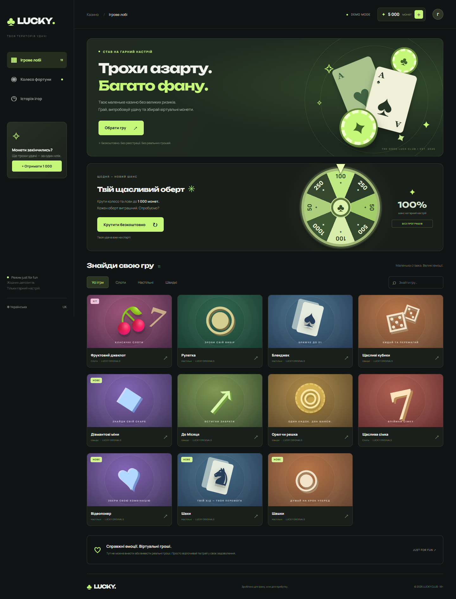
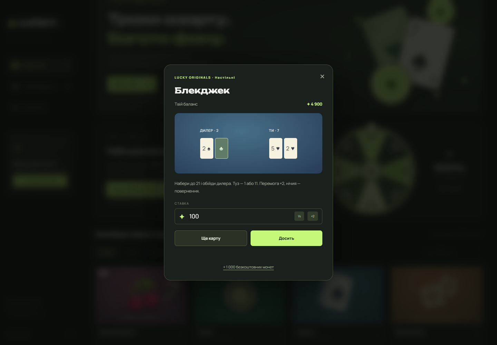
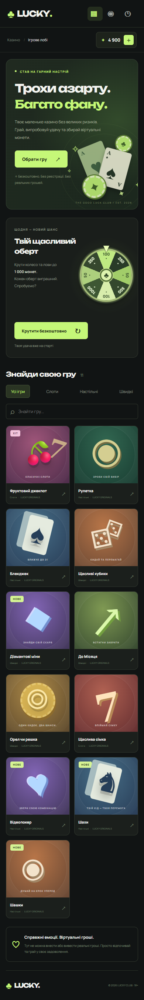
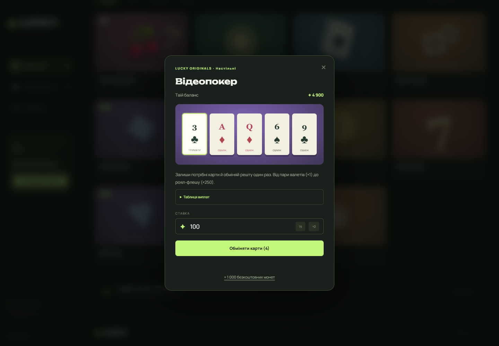
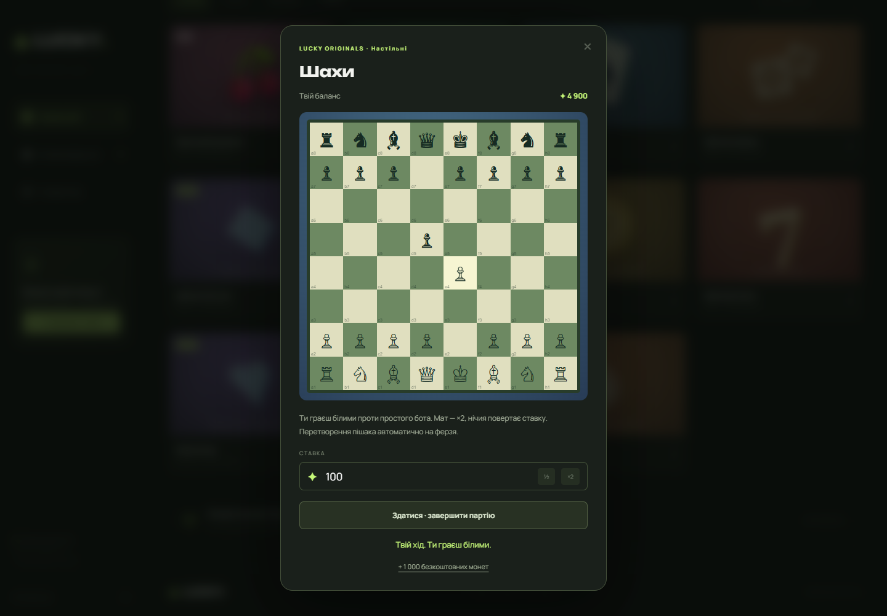
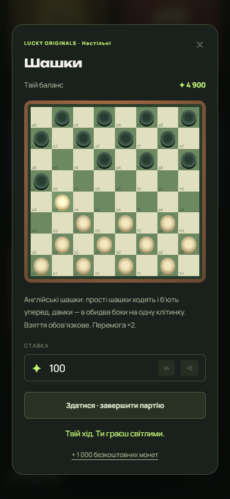

# ♣ LUCKY — грай заради настрою

Україномовне казино **винятково для розваг**, побудоване на **Angular 22 та TypeScript 6**. Одинадцять мініігор, колесо фортуни та віртуальний гаманець у темному інтерфейсі з лаймовими акцентами.

**Жодних реальних ставок, платежів чи виведення коштів.** Усі монети умовні й не мають грошової цінності.

## Запуск

Потрібен Node.js **22.22.3 або новіший сумісний з Angular 22** та npm.

```sh
npm ci
npm start
```

Відкрийте **http://127.0.0.1:4200**.

```sh
npm run build  # production-збірка у dist/lucky/browser
npm test      # браузерні перевірки Playwright
```

Тести використовують встановлений **Microsoft Edge** (`channel: 'msedge'`). Якщо Edge відсутній, установіть Chromium командою `npx playwright install chromium` і приберіть `channel` із `playwright.config.ts`. Playwright сам запускає сервер, якщо його ще немає.

## Що всередині

- Початковий баланс — **5 000 монет**. Кнопка «+» та кнопки безкоштовного поповнення додають **1 000 монет** без обмеження кількості натискань.
- **Колесо фортуни:** безкоштовний анімований оберт із гарантованим призом 50, 100, 250, 500 або 1 000 монет. Можна крутити повторно після завершення анімації.
- **Одинадцять ігор**, пошук за назвою та фільтри за категоріями.
- **Історія останніх 30 операцій:** ставки, виграші та поповнення.
- Збереження балансу й історії в **localStorage** цього браузера.
- Адаптивна верстка для комп'ютера, планшета й телефона.
- Підтримка клавіатури: видимий фокус, утримання фокуса у вікні гри, Escape для закриття завершеної гри. Підтримка зменшення анімації через `prefers-reduced-motion`.
- Шрифти **Manrope та Unbounded** включені в збірку; зовнішні запити до Google Fonts не потрібні. Ілюстрації створені стилями CSS і символами, без платних зображень.

## Ігри та правила

| Гра | Як грати | Виплата |
| --- | --- | --- |
| 🍒 Фруктовий джекпот | Запустіть три барабани з трьома видами символів | Три однакові: ×5; рівно два: ×1,2 |
| ◉ Рулетка | Оберіть червоне (непарні), чорне (парні) або зелений 0; випадає 0–36 | Колір: ×2; нуль: ×36 |
| ♠ Блекджек | Беріть карти або зупиніться. Мета — обійти дилера, не перевищивши 21. Туз: 1 або 11; дилер добирає до 17 | Перемога: ×2; нічия: повернення ставки |
| ⚄ Щасливі кубики | Киньте два шестигранні кубики | Сума 8–12: ×2 |
| ◆ Діамантові міни | На полі 4×4 приховано 3 міни. Відкривайте безпечні клітинки, потім забирайте монети | Множник зростає з кожним діамантом; міна скасовує виграш |
| ↗ До Місяця | Запустіть політ і натисніть «Забрати» до випадкової зупинки | Ставка × поточний множник |
| ◎ Орел чи решка | Вгадайте сторону монети | ×2 |
| 7 Щаслива сімка | Варіант слотів із символами 7, ★, ◆ | Три однакові: ×5; рівно два: ×1,2 |
| ♥ Відеопокер | Колода 52 карти без повторів. Утримуйте потрібні карти й один раз обміняйте решту | Пара валетів і вище ×1, дві пари ×2, трійка ×3, стріт ×4, флеш ×6, фул-хаус ×9, каре ×25, стріт-флеш ×50, роял-флеш ×250 |
| ♞ Шахи | Грайте білими проти простого комп'ютерного суперника; оберіть фігуру й підсвічений хід | Мат супернику ×2; нічия повертає ставку |
| ◉ Шашки | Англійські шашки на дошці 8×8 проти комп'ютера | Перемога ×2; нічия повертає ставку |

Множники означають **повну виплату разом зі ставкою**, а не чистий прибуток. Ставка списується на початку раунду. Діапазон ставки — 10–10 000 монет. Виплати округлюються до цілої монети. Рулетка має спрощену схему кольорів, блекджек — незалежні випадкові карти без поділу рук, страхування та окремої виплати за натуральний блекджек.

У мінах множник після `k` безпечних відкриттів дорівнює добутку `(16-i)/(13-i)` для `i=0…k-1`, округленому вниз до сотих. Відкриття всіх 13 діамантів автоматично виплачує виграш. Політ випадково завершується на порозі 1,00–4,99×; відображуваний множник зростає кроком 0,05× кожні 120 мс.

## Скриншоти

### Ігрове лобі — комп'ютер

Головна сторінка: гаманець, безкоштовне поповнення, ілюстрація з картами, колесо фортуни, категорії та каталог із одинадцяти ігор.



### Блекджек

Вікно гри з картами дилера й гравця, правилами, ставкою, балансом та кнопками дій. Під час активного раунду закриття заблоковане, щоб спочатку завершити гру.



### Мобільна версія

Інтерфейс на екрані 390 px: компактна навігація, адаптоване колесо, пошук і двоколонковий каталог.



## Технічні деталі

### Нові настільні ігри

**Відеопокер** — одиночна гра формату Jacks or Better, а не техаський холдем. Підсвічені карти залишаються в руці після обміну. Таблиця виплат доступна безпосередньо у вікні гри.



**Шахи:** легальність ходів перевіряє `chess.js`: шах, мат, пат, рокіровка, взяття на проході, повторення позиції та недостатній матеріал. Перетворення пішака автоматично на ферзя. Простий бот віддає перевагу мату, взяттям та шахам; це не турнірний двигун. Кнопка «Здатися» завершує гру з втратою ставки.



**Шашки:** використано англійський варіант — прості шашки ходять та б'ють лише вперед; дамки ходять на одну клітинку й б'ють в обидва боки. Взяття обов'язкове; серію взяттів потрібно закінчити тією самою фігурою. Перетворення на дамку завершує хід. Відсутність легальних ходів означає поразку. Для цього демо нічия настає після 80 півходів без взяття або перетворення; це спрощене правило. Комп'ютер обирає випадковий легальний хід.



### Реалізація

- Angular standalone-компонент, реактивний стан на **Signals**, строгі TypeScript і перевірка шаблонів.
- CSS без UI-бібліотеки, локальні variable-шрифти через Fontsource.
- Випадкові значення — через браузерний `crypto.getRandomValues`.
- Ключ збереження: `lucky-v1`. Щоб почати знову, очистіть дані сайту в браузері.
- Застосунок повністю клієнтський: немає сервера облікових записів, синхронізації між пристроями або захисту балансу від редагування користувачем.
- Незавершені раунди не відновлюються після перезавантаження: уже списана ставка залишається в історії, невиплачений виграш не зараховується.

## Перевірки

Браузерні тести покривають поповнення та збереження балансу, фільтри, пошук, історію, одноразове зарахування виграшу колеса, усі одинадцять ігор, недостатній баланс, некоректну ставку та відсутність горизонтального переповнення на телефоні. Тест візуальної перевірки оновлює шість PNG-скриншотів в `docs/screenshots`.

## Структура

```text
src/
  main.ts              # стан, баланс, правила й логіка ігор
  table-games.ts       # оцінка покерних комбінацій і правила шашок
  app.html             # український інтерфейс
  styles.css           # адаптивний дизайн та ілюстрації
  index.html           # метадані й точка входу
tests/casino.spec.ts    # браузерні сценарії
tests/table-games.spec.ts # перевірка правил та нових настільних ігор
docs/screenshots/      # фактичні скриншоти застосунку
angular.json           # конфігурація Angular
playwright.config.ts   # конфігурація тестів
```
